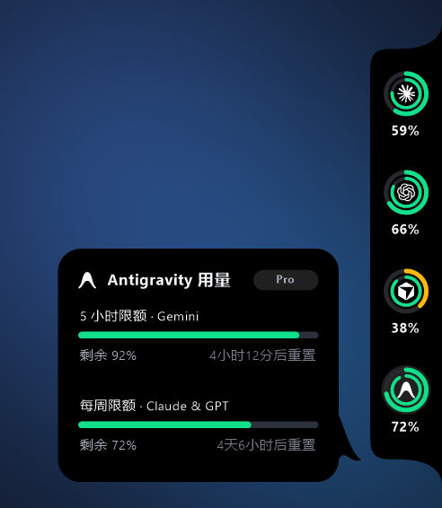
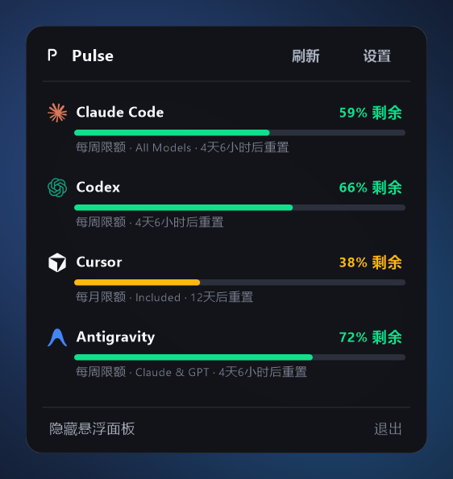
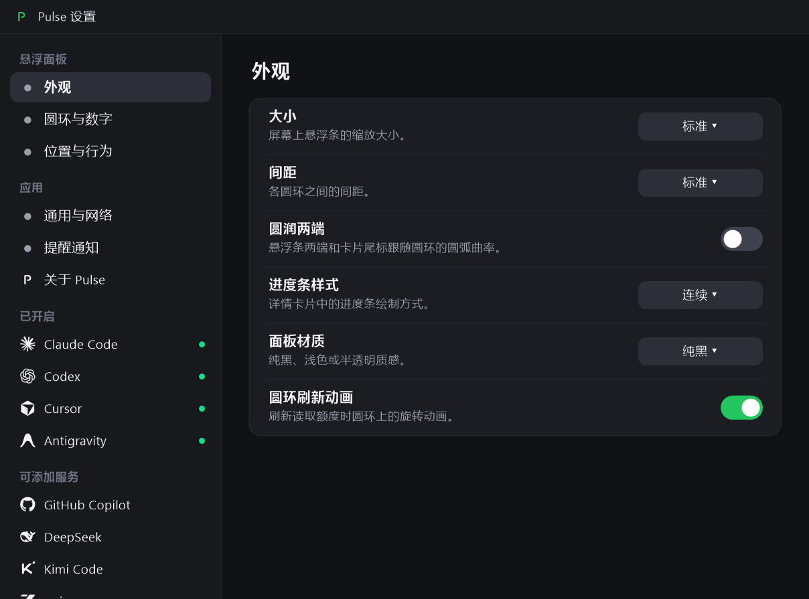

<p align="center">
  
</p>

<h1 align="center">Pulse for Windows</h1>

<p align="center">
  <b>不用挨个打开用量页面，就知道 Claude Code、Codex、Cursor、Antigravity 还剩多少额度。</b><br>
  免费开源的 Windows 原生 AI 编程额度监控工具，采用 Go + Win32 + GDI+ 编写，贴合屏幕边缘与系统托盘显示。
</p>

<p align="center">
  <a href="https://github.com/feicai922/Pulse-win/releases/latest"></a>
</p>

<p align="center">
  <a href="https://github.com/feicai922/Pulse-win/releases/latest"></a>
  <a href="https://github.com/feicai922/Pulse-win/releases"></a>
  <a href="https://github.com/feicai922/Pulse-win/stargazers"></a>
  <a href="LICENSE"></a>
</p>

<p align="center">
  <sub><b>Windows 10 / 11 (x64)</b> · 原生 Go + Win32 + GDI+（无 Electron 开销）· <a href="README.md"><b>English</b></a> · <b>简体中文</b> · <a href="windows/README.md"><b>Windows 构建说明</b></a></sub>
</p>

<p align="center">
  
  &nbsp;&nbsp;
  
</p>

<p align="center">
  
</p>

---

- **轻量原生体验**——纯 Go（`CGO_ENABLED=0`）+ Win32 API + GDI+ 实现，无 Electron / Chromium 运行时，内存占用约 10–18 MB，完整支持 Per-Monitor V2 高分屏缩放。
- **内置 22 个主流 AI 服务商**——支持 Claude Code、Codex、Cursor、GitHub Copilot、Antigravity、Gemini CLI、Grok CLI、DeepSeek、Kimi Code、z.ai、智谱 GLM Coding Plan、MiniMax、OpenCode Go、Kiro 等。
- **纯本地运行，保护隐私**——仅使用你本机的登录态或 API Key 直连对应服务商，不经过任何中转服务器；所有手动保存的 Key 均通过 **Windows DPAPI** 加密存放在本机。
- **完整还原 Pulse 交互与视觉**——屏幕边缘停靠圆角胶囊、闲置自动收起细线、指针悬停详情气泡卡、系统托盘实时用量环与快捷面板弹窗、深色原生设置窗口。

---

## 下载与安装

### 方式一：图形安装向导（推荐）
1. 前往 [Releases](https://github.com/feicai922/Pulse-win/releases/latest) 下载 **`PulseSetup.exe`**。
2. 双击运行安装程序，选择安装目录（默认 `%LOCALAPPDATA%\Programs\Pulse`），按需勾选桌面/开始菜单快捷方式与开机自启动。
3. 支持在 Windows **设置 → 应用 → 已安装的应用** 中一键卸载（或执行 `Pulse.exe --uninstall`）。

### 方式二：绿色免安装版
从 [Releases](https://github.com/feicai922/Pulse-win/releases/latest) 下载独立的 **`Pulse.exe`**，直接双击运行即可。

---

## 核心特性

### 屏幕边缘悬浮面板
- **任意边缘停靠**——支持停靠在屏幕**右侧、左侧、顶部、底部**，或**自由竖向/横向悬浮**；支持跨多显示器拖动实时吸附，并可选**跟随鼠标所在显示器**。
- **闲置自动收起**——无操作时自动折叠为屏幕边缘细线（超限耗尽时变为红色提示），鼠标移近瞬间展开。
- **悬停详情卡片**——鼠标指向任意圆环即可展开详细额度卡：各时间窗口限额、连续/分段进度条、已用或剩余百分比、重置倒计时、按当前速率的耗尽预测以及余额显示。
- **外观与隐私保护**——支持**深邃纯黑 / 浅色 / 半透明**材质，以及**截图/录屏时自动隐藏**（`WDA_EXCLUDEFROMCAPTURE`）。

### 系统托盘与快捷键
- **托盘实时用量圆环**——在系统托盘图标实时绘制当前最高用量百分比与圆环进度。
- **左键快捷面板 / 右键菜单**——左键点击托盘图标打开或收起快捷面板弹窗；右键菜单支持快速切换悬浮面板、立即刷新、开关开机自启、打开设置与退出。
- **全局快捷键**——默认 `Ctrl+Alt+P` 一键显示或隐藏悬浮窗（可在设置中自定义）。

### 支持的服务商（22 个）
- **本地自动读取**：Claude Code、Codex、Cursor（纯 Go 读取 `state.vscdb` + Windows DPAPI 解密）、Antigravity（自动探测本机 Language Server 端口与 CSRF Token，并支持 `agy.exe` CLI 回退读取）、Gemini CLI、Grok CLI。
- **OAuth / API Key 配置**：GitHub Copilot（内置 GitHub Device Code 登录）、DeepSeek、Kimi Code、z.ai、Zhipu（GLM Coding Plan）、MiniMax（支持 `minimax.io` / `minimaxi.com`）、OpenCode Go、Command Code、Volcengine（`arkcli`）、Alibaba Coding Plan、Moonshot、OpenAI API、Kilo Code、sub2api、New API、Kiro。

### 数据存储与命令行
- API 密钥通过 **Windows DPAPI** 加密保存于 `%APPDATA%\Pulse\keys.dat`，配置保存于 `%APPDATA%\Pulse\settings.json`。
- 支持 `Pulse.exe --json` 输出缓存快照 JSON，方便接入脚本或状态栏工具。

---

## 从源码构建（Windows）

需要 **Go 1.24+**（在 Go 1.27 `windows/amd64` 下验证，无需安装 C 编译器 / CGO）：

```powershell
git clone https://github.com/feicai922/Pulse-win.git
cd Pulse-win\windows
go test ./...
.\build.ps1
```

`.\build.ps1` 会依次完成：
1. 运行 `cmd/genrsrc` 从 `AppIcon/pulse-icon-1024.png` 生成多分辨率 `.ico` 及 PE 资源文件（`*.syso`）；
2. 编译主程序 `Pulse.exe`；
3. 将 `Pulse.exe` 压缩打包进图形安装程序 `PulseSetup.exe`（使用 `-tags installer`）。

---

## 上游项目与致谢

- 本仓库为 [qunqin24/Pulse](https://github.com/qunqin24/Pulse) 的 Windows 移植版本（原始 macOS Swift/SwiftUI 代码保留在 `Sources/` 目录）。
- UI 设计灵感源自 [**Vinz** (@hivinz_)](https://x.com/hivinz_/status/2092996055248126353)。
- 基于 [Apache 2.0 协议](LICENSE) 开源。第三方声明见 [THIRD_PARTY_NOTICES.md](THIRD_PARTY_NOTICES.md)。
